<p align="center">
  <picture>
    <source media="(prefers-color-scheme: dark)" srcset="docs/media/logo-dark.svg">
    
  </picture>
</p>

<p align="center">
  One self-hosted library for the pages all your coding agents make — plans, progress, reviews, reports, questionnaires.<br>
  Claude Code, Codex and OpenCode publish to it, read from it and pick up your answers. Every version kept, every link stable.
</p>

<p align="center">
  <a href="https://github.com/plugincompany/artifact-library/actions/workflows/ci.yml"></a>
  <a href="https://github.com/plugincompany/artifact-library/releases"></a>
  <a href="LICENSE"></a>
  <a href="https://github.com/plugincompany/artifact-library/pkgs/container/artifact-library"></a>
</p>

<p align="center">
  <a href="#quick-start">Quick start</a> ·
  <a href="#features">Features</a> ·
  <a href="#using-it-with-agents">Agents</a> ·
  <a href="docs/">Docs</a>
</p>

https://github.com/user-attachments/assets/d76449c8-ae6c-410e-a08d-fa6b91edfac9

<p align="center"><sub>The 2½-minute intro: planning, progress, code review, reports and sharing. ▶ <a href="https://github.com/PluginCompany/artifact-library/releases/download/v0.4.0/artifact-library-intro-4k60.mp4">Watch it in 4K, 60 fps</a></sub></p>

---

Coding agents produce plans, progress updates, reviews and reports, and then lose them in a chat that scrolls away. When you answer their questions, the agent has to dig your reply out of the conversation.

**Artifact Library gives that work a home:**

- **Publish:** the agent publishes a folder of HTML with one command and shares a stable link.
- **Read:** you open it in the browser, with every version kept.
- **Answer on the page:** pick an option, comment on a finding, approve a change.
- **Read back:** the agent picks up your answers with `artifact feedback` and replies in the same thread.

**One library for every agent.** Claude Code writes the plan, Codex builds it and reports progress on a live page, OpenCode reviews the result. They all publish to, search and read the same library through the same CLI, skill or MCP server, so an answer you give on one agent's page is there for the next agent to pick up.

## What it's for

Anything an agent would otherwise dump into a chat, as a page you can read, answer and share.

> **Publish anything that runs in a browser.** Any static folder works: a single hand-written HTML file, a React, Vue or Svelte build, a generated report, a slide deck, a prototype with its own JavaScript, images, video, fonts or WebAssembly. Files are served exactly as uploaded, with no framework, template or content rules. The references below are optional starting points, not a format you have to follow.

For common jobs there is a polished reference on the server that agents copy and fill in:

| Use case | What the page does | Starts from |
|---|---|---|
| **Planning** | A plan deck, open questions you answer with a click, options weighed in a decision record, scope cut to fit | `ref-plan-deck`, `ref-decision-questionnaire`, `ref-decision-record`, `ref-scope-slicer`, `ref-prototype-variants` |
| **Progress tracking** | A live run log the agent updates while it works; blockers you answer on the page | `ref-live-run-log`, `ref-runbook`, `ref-debug-notebook` |
| **Code review** | Findings on annotated screenshots, a walkthrough with a verdict per chapter, before/after diffs to approve | `ref-implementation-review`, `ref-code-walkthrough`, `ref-visual-regression` |
| **Results and evidence** | The agent's proof of done: criteria linked to the checks that prove them, before/after, what was restored, and your sign-off | `ref-results-evidence` |
| **Reporting** | Multi-page reports with charts and table views, test and performance results against budgets, a weekly digest | `ref-ops-report`, `ref-test-report`, `ref-weekly-digest` |
| **Feature tours and showcases** | A guided tour of a product or a release: real screenshots with callouts, paths per role, a player that walks every feature | `ref-feature-tour` |
| **User guides** | Step-by-step processes on real screenshots for the people who use a product, searchable, in two languages, with a question box per topic | `ref-user-guide` |
| **Explaining a system** | Architecture tours with clickable diagrams, a map of an unfamiliar codebase | `ref-architecture-tour`, `ref-codebase-map` |

<table>
<tr>
<td width="33%">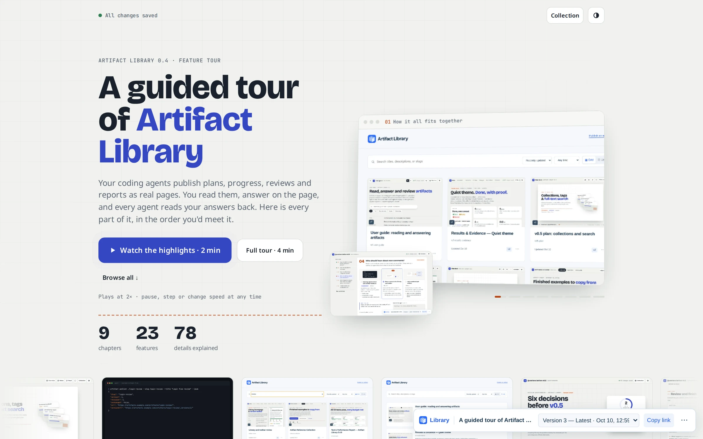</td>
<td width="33%">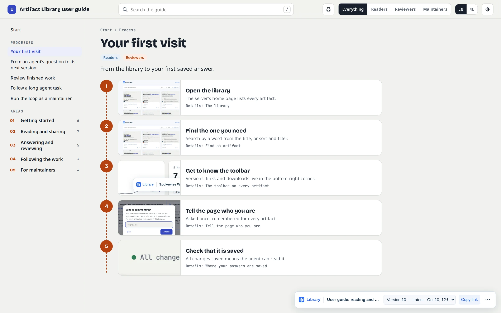</td>
<td width="33%">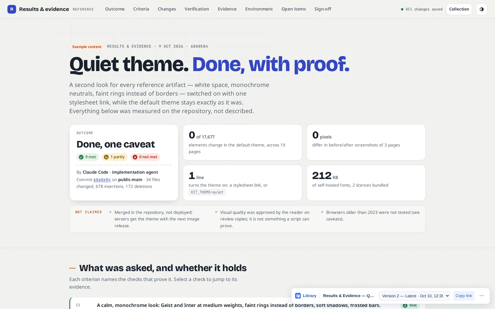</td>
</tr>
<tr>
<td><b>Feature tour.</b> Show people around a product, chapter by chapter.</td>
<td><b>User guide.</b> Processes and steps on real screenshots.</td>
<td><b>Results and evidence.</b> Proof of done, signed off on the page.</td>
</tr>
</table>

## Quick start

**1. Run a server** (seeds a reference collection and a guide for agents on first start)

```bash
docker run -d --name artifacts -p 3000:3000 -v artifact-data:/data \
  -e PUBLIC_BASE_URL=http://localhost:3000 ghcr.io/plugincompany/artifact-library:0.7.1
```

**2. Install the CLI** — standalone binaries, no Node.js needed

```bash
curl -fsSL https://raw.githubusercontent.com/plugincompany/artifact-library/main/install.sh | sh   # Linux, macOS
irm https://raw.githubusercontent.com/plugincompany/artifact-library/main/install.ps1 | iex        # Windows
artifact config set server http://localhost:3000
```

**3. Give your agent the skill or the MCP server**

```bash
artifact skill install --agent claude,codex,opencode   # one skill, every agent
claude mcp add artifact -- artifact mcp        # any MCP-capable agent
```

Then ask your agent for a plan, a review or a report "as an artifact". Open <http://localhost:3000> to see the library.

## Features

### A library for everything your agents publish

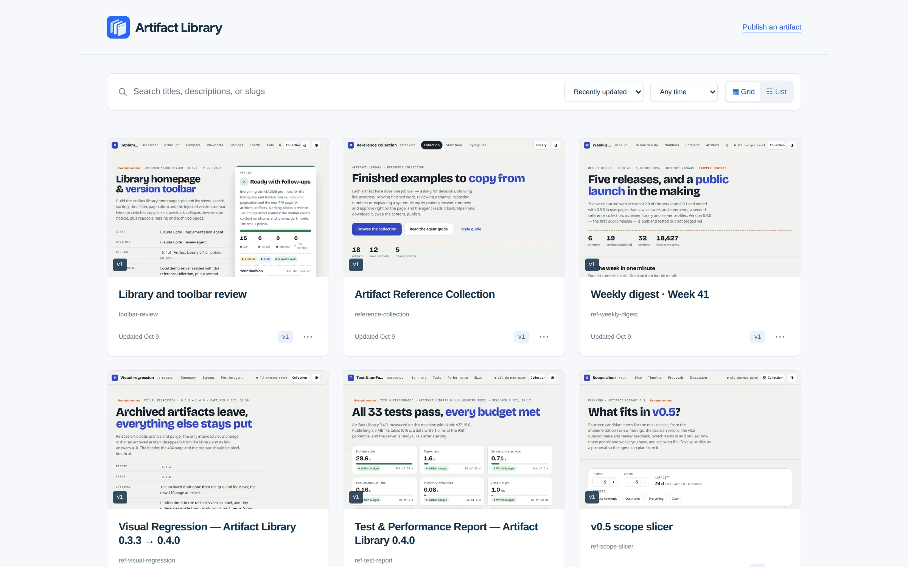

- **One command to publish any static site**: a folder of HTML, CSS, JavaScript, images, fonts, video or WebAssembly, served exactly as uploaded: `artifact publish ./review --title "Login review"`. Bring your own build or start from a reference.
- **Stable links and immutable versions.** `/artifacts/<slug>/` always shows the latest; every version stays at its own URL. Updates never change a published snapshot.
- **Server-side previews**, search, sorting, time filters and grid or list views.
- **Version toolbar** on every page: switch versions, copy links, download, and a quiet "new version available" notice instead of surprise reloads.

### Feedback on the page, read by the agent

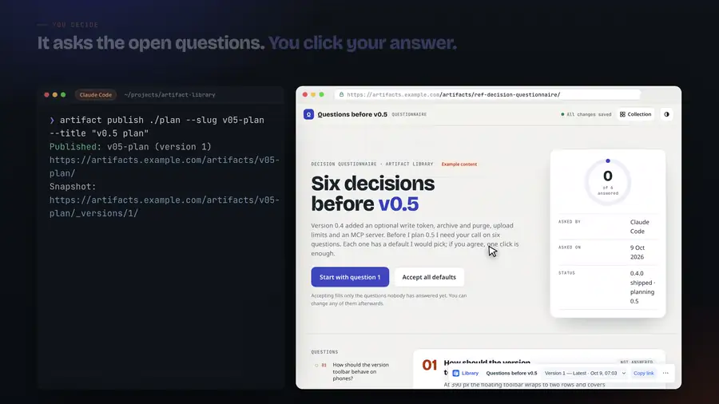

<table>
<tr>
<td width="50%">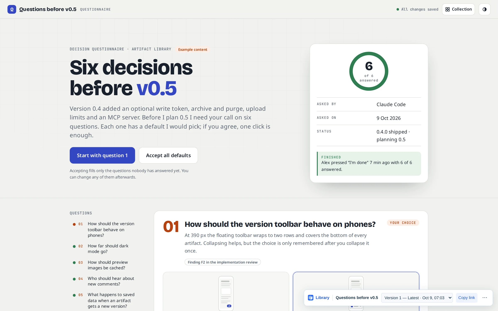</td>
<td width="50%">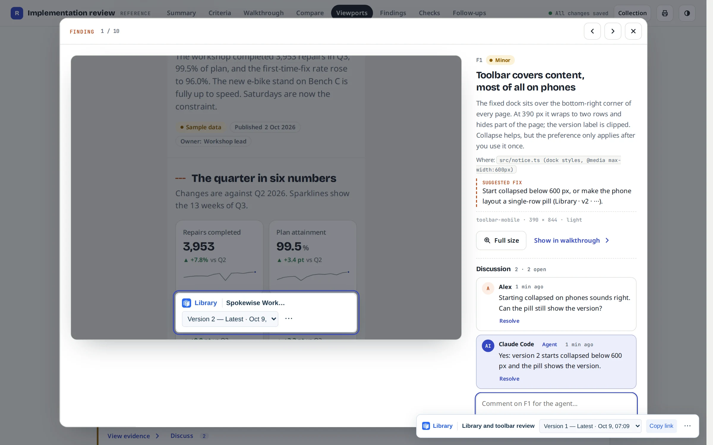</td>
</tr>
<tr>
<td><b>Questionnaires.</b> The agent asks several decisions at once; you pick options and add notes.</td>
<td><b>Reviews.</b> Comment on a finding, approve or request changes, tick follow-ups.</td>
</tr>
</table>

- Answers, comments, verdicts and live state are **saved beside the artifact**, not inside it, so they survive new versions.
- Agents read everything with `artifact feedback <slug>` and **reply in the same thread** with `artifact data append`; resolved threads show up as resolved on the page.
- **Live pages**: a run log the agent updates with `artifact data set` — no new versions, readers see progress within seconds.

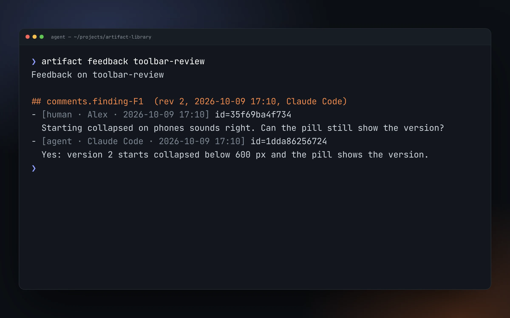

### A reference collection agents copy from

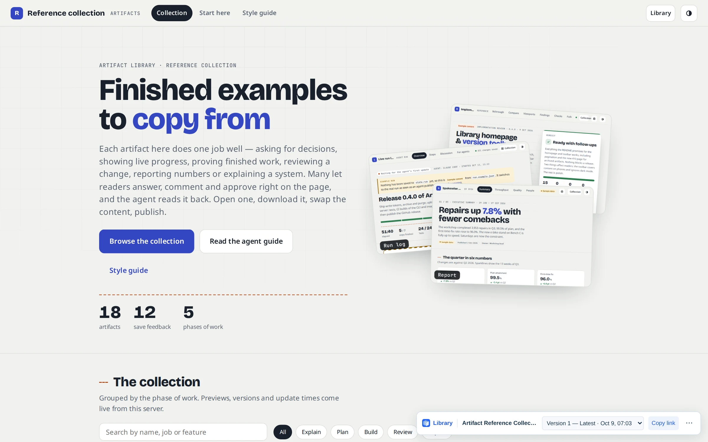

Every server ships **21 polished reference artifacts**, one per common job. Agents download the closest one, swap the content and publish; the plumbing (saving answers, comment threads, charts, print, phones) is already done.

| Phase | References |
|---|---|
| **Plan** | Plan deck · Decision questionnaire · Prototype variants · Scope slicer · Decision record |
| **Build** | Live run log · Debug notebook · Runbook |
| **Review** | Implementation review · Results and evidence · Code walkthrough · Visual regression · Test report |
| **Report** | Multi-page report · Weekly digest |
| **Explain** | Feature tour · User guide · Architecture tour · Codebase map |
| **Start here** | Guide for agents · CLI and skill install page |

- **One design system** (`kit/`) behind all of them, with its own style guide on the collection hub: light and dark mode, charts with table views, comment threads, self-hosted fonts.
- **Two styles, Bold and Clean**: the expressive default and a plain documentation look (hairline borders, semibold Inter, one blue accent). Readers switch with a button on every kit page; authors pick the default.
- **Seeded on every server** and updated with new releases, without overwriting your own edits.

[See the collection →](docs/reference-collection.md)

<table>
<tr>
<td width="50%">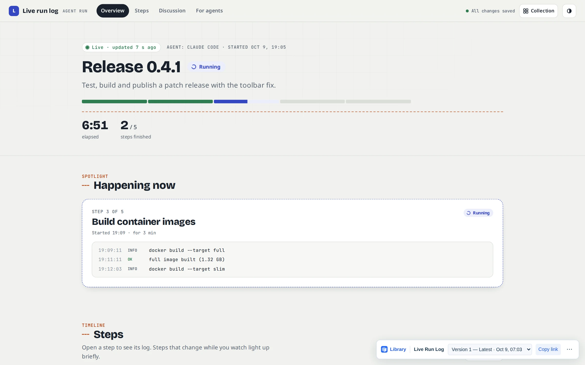</td>
<td width="50%">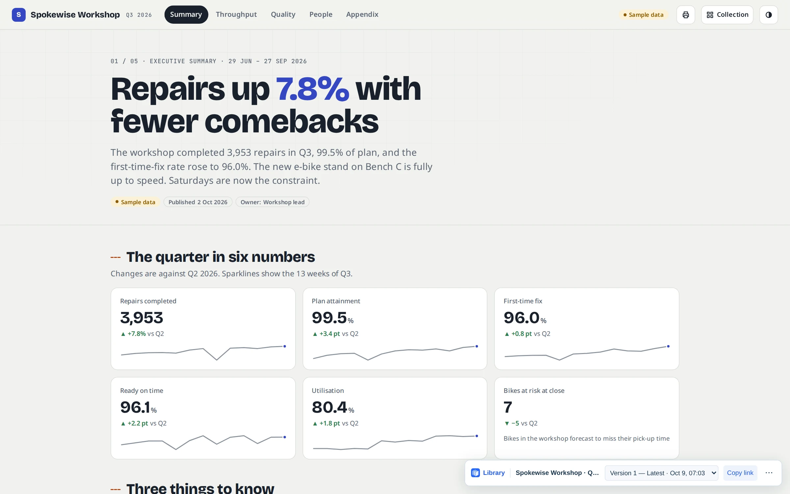</td>
</tr>
</table>

### Built for agents — all of them

- **One shared library**: every agent on every machine publishes to and reads from the same server. Plans from one agent, progress from another, reviews from a third, all at stable links you and the agents can pass around.
- **Agent skill** for Claude Code, OpenCode and Codex: `artifact skill install --agent claude`. It teaches the publish → share → feedback → update loop and points to the reference collection.
- **MCP server**: `artifact mcp` exposes search, publish, update, download, feedback, saved data and create-from-reference as tools for any MCP client.
- **Self-review with `artifact lint`**: the server renders the page at desktop and phone width and reports layout, navigation and readability problems, with screenshots for agents that have no browser.
- **Agent-friendly CLI**: `--json` everywhere, stable exit codes, idempotent uploads with `artifact retry`, optimistic revisions, `check` and `diff` against local folders, profiles for several servers.

### Safe to run

- **Static only**: uploaded files are served to the browser, never executed on the server. Pages keep their own JavaScript; the version toolbar can be turned off per artifact (`--no-toolbar`).
- **Optional write token** (`ARTIFACT_TOKEN`) for publishing, updates, archive and purge; reading and reader feedback stay open.
- **Archive and purge**: hide an artifact (reversible) or delete it with all its versions and comments.
- **Upload limits** (500 MB / 10,000 files by default), size limits on saved data, and pages cannot write other artifacts' data.
- Designed for private networks like a Tailscale tailnet. Read the [security model](SECURITY.md) before exposing it.

### Runs anywhere

- **One container**, one data volume, no database. Multi-arch images: full (with previews) and **slim** (~290 MB).
- **CLI binaries** for Linux, macOS and Windows on x64 and arm64.
- Seeded defaults update themselves on upgrade and never overwrite your edits.

## How it works

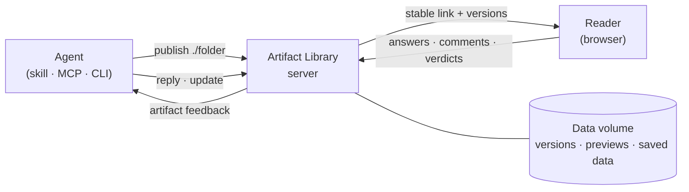

- **Versions:** every publication is a complete snapshot of a folder, stored once and served at `/artifacts/<slug>/_versions/<n>/`. The stable link `/artifacts/<slug>/` redirects to the latest.
- **Toolbar:** a small version toolbar is injected into HTML on the way out; the stored bytes never change.
- **Previews:** rendered by a headless Chromium inside the full image.
- **Saved data:** answers, comments and live state are small JSON documents next to the versions, read and written through `/api/v1/artifacts/<slug>/data`.

## Using it with agents

```bash
# the agent, after building something
artifact download ref-implementation-review --out ./toolbar-review      # start from a reference
artifact publish ./toolbar-review --slug toolbar-review \
  --title "Library and toolbar review" --description "Criteria, annotated screenshots and findings."

# you answer on the page, then tell the agent "check the artifact"
artifact feedback toolbar-review
artifact data append toolbar-review comments.finding-F1 --author "Claude Code" \
  --item '{"text":"Yes: version 2 starts collapsed below 600 px and the pill shows the version."}'
artifact update toolbar-review ./toolbar-review --message "Start the toolbar collapsed on phones"
```

More in [docs/agents.md](docs/agents.md).

## Configuration

| Server variable | Default | |
|---|---|---|
| `PUBLIC_BASE_URL` | `http://localhost:3000` | Origin used in links the API returns |
| `ARTIFACT_TOKEN` | unset | Require a bearer token for writes |
| `MAX_UPLOAD_BYTES` / `MAX_FILES` | 500 MB / 10,000 | Per-upload limits (`0` = unlimited) |
| `PREVIEWS` | on (full) / off (slim) | Server-side preview images |
| `SEED` | on | Seed the reference collection and agent guide |

Compose file, reverse proxy and Tailscale examples, backups and upgrades: [docs/deployment.md](docs/deployment.md).

## Documentation

| | |
|---|---|
| [CLI reference](docs/cli.md) | Every command, configuration, profiles, exit codes |
| [Agents](docs/agents.md) | Skill, MCP server, the feedback loop |
| [Saved data](docs/saved-data.md) | Answers, comments and live state from pages and agents |
| [Reference collection](docs/reference-collection.md) | The 21 references, the shared kit and its themes |
| [Deployment](docs/deployment.md) | Docker, Compose, TLS, backups, upgrades |
| [HTTP API](docs/api.md) | Routes, headers, errors |
| [Release process](docs/release-process.md) | How releases are built and published |

## Contributing

Issues and pull requests are welcome — see [CONTRIBUTING.md](CONTRIBUTING.md) and the [code of conduct](CODE_OF_CONDUCT.md). Report security issues privately as described in [SECURITY.md](SECURITY.md).

```bash
npm ci && npm test        # Node.js 22+
npm run dev               # server on http://localhost:3000
```

## License

[Apache License 2.0](LICENSE). The name "Artifact Library" and its logo are trademarks of Plugin Company; forks are welcome under a different name (see [NOTICE](NOTICE)).
