<p align="center">
  <picture>
    <source media="(prefers-color-scheme: dark)" srcset="docs/media/logo-dark.svg">
    
  </picture>
</p>

<p align="center">
  One self-hosted library for the pages all your coding agents make — plans, progress, reviews, reports, questionnaires.<br>
  Claude Code, Codex and OpenCode publish to it, read from it and pick up your answers. Every version kept, every link stable.
</p>

<p align="center">
  <a href="https://github.com/plugincompany/artifact-library/actions/workflows/ci.yml"></a>
  <a href="https://github.com/plugincompany/artifact-library/releases"></a>
  <a href="LICENSE"></a>
  <a href="https://github.com/plugincompany/artifact-library/pkgs/container/artifact-library"></a>
</p>

<p align="center">
  <a href="#quick-start">Quick start</a> ·
  <a href="#features">Features</a> ·
  <a href="#using-it-with-agents">Agents</a> ·
  <a href="docs/">Docs</a>
</p>

https://github.com/user-attachments/assets/d76449c8-ae6c-410e-a08d-fa6b91edfac9

<p align="center"><sub>The 2½-minute intro: planning, progress, code review, reports and sharing. ▶ <a href="https://github.com/PluginCompany/artifact-library/releases/download/v0.4.0/artifact-library-intro-4k60.mp4">Watch it in 4K, 60 fps</a></sub></p>

---

Coding agents produce plans, progress updates, reviews and reports, and then lose them in a chat that scrolls away. When you answer their questions, the agent has to dig your reply out of the conversation.

**Artifact Library gives that work a home:**

- **Publish:** the agent publishes a folder of HTML with one command and shares a stable link.
- **Read:** you open it in the browser, with every version kept.
- **Answer on the page:** pick an option, comment on a finding, approve a change.
- **Read back:** the agent waits for your answers with `artifact wait` (or picks them up with `artifact feedback`) and replies in the same thread.

**One library for every agent.** Claude Code writes the plan, Codex builds it and reports progress on a live page, OpenCode reviews the result. They all publish to, search and read the same library through the same CLI, skill or MCP server, so an answer you give on one agent's page is there for the next agent to pick up.

## What it's for

Anything an agent would otherwise dump into a chat, as a page you can read, answer and share.

> **Publish anything that runs in a browser.** Any static folder works: a single hand-written HTML file, a React, Vue or Svelte build, a generated report, a slide deck, a prototype with its own JavaScript, images, video, fonts or WebAssembly. Files are served exactly as uploaded, with no framework, template or content rules. The references below are optional starting points, not a format you have to follow.

For common jobs there is a polished reference on the server that agents copy and fill in:

| Use case | What the page does | Starts from |
|---|---|---|
| **Planning** | A plan deck, open questions you answer with a click (option cards with trade-offs and a recommended default), options weighed in a decision record, scope cut to fit | `ref-plan-deck`, `ref-decision-questionnaire`, `ref-decision-record`, `ref-scope-slicer`, `ref-prototype-variants` |
| **Progress tracking** | A live run log the agent updates while it works; blockers you answer on the page; a runbook you and the agent tick off together; a bug investigation with hypotheses, evidence, root cause and fix | `ref-live-run-log`, `ref-runbook`, `ref-debug-notebook` |
| **Code review** | A change explained with its reasoning, screenshots and short diffs, decisions you confirm or overrule and a verdict; findings on annotated screenshots; a walkthrough with a verdict per chapter; before/after diffs to approve | `ref-code-review`, `ref-implementation-review`, `ref-code-walkthrough`, `ref-visual-regression` |
| **Results and evidence** | The agent's proof of done: criteria linked to the checks that prove them, before/after, what was restored, and your sign-off | `ref-results-evidence` |
| **Reporting** | Multi-page reports with charts and table views, test and performance results against budgets, a weekly digest | `ref-ops-report`, `ref-test-report`, `ref-weekly-digest` |
| **Feature tours and showcases** | A guided tour of a product or a release: real screenshots with callouts, paths per role, a player that walks every feature | `ref-feature-tour` |
| **User guides** | Step-by-step processes on real screenshots for the people who use a product, searchable, in two languages, with a question box per topic | `ref-user-guide` |
| **Explaining a system** | Architecture tours with clickable diagrams, a map of an unfamiliar codebase | `ref-architecture-tour`, `ref-codebase-map` |

<table>
<tr>
<td width="33%">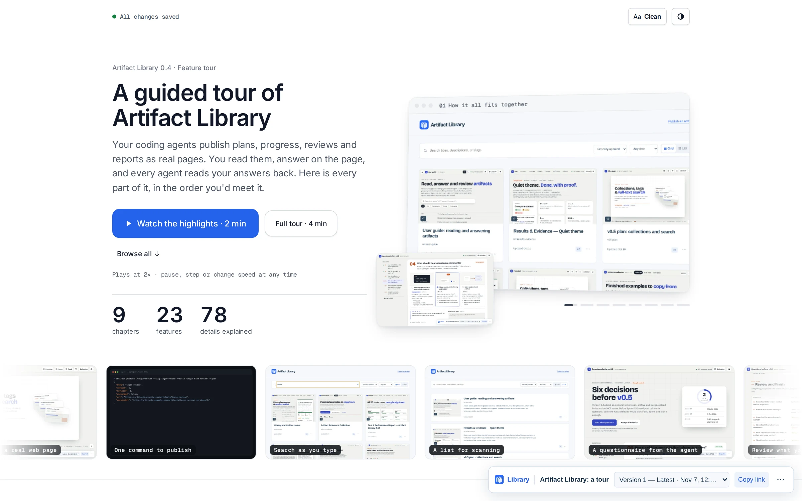</td>
<td width="33%">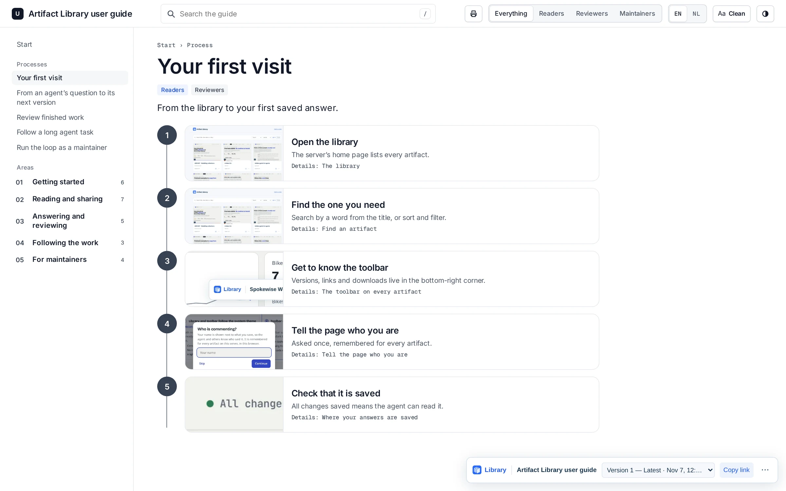</td>
<td width="33%">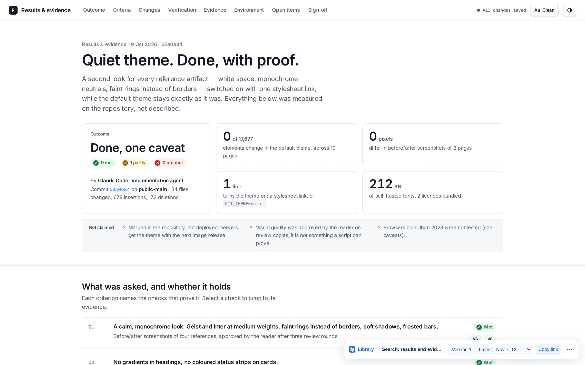</td>
</tr>
<tr>
<td><b>Feature tour.</b> Show people around a product, chapter by chapter.</td>
<td><b>User guide.</b> Processes and steps on real screenshots.</td>
<td><b>Results and evidence.</b> Proof of done, signed off on the page.</td>
</tr>
</table>

## Quick start

**1. Run a server** (seeds a reference collection and a guide for agents on first start)

```bash
docker run -d --name artifacts -p 3000:3000 -v artifact-data:/data \
  -e PUBLIC_BASE_URL=http://localhost:3000 ghcr.io/plugincompany/artifact-library:0.13.1
```

**2. Install the CLI** — standalone binaries, no Node.js needed

```bash
curl -fsSL https://raw.githubusercontent.com/plugincompany/artifact-library/main/install.sh | sh   # Linux, macOS
irm https://raw.githubusercontent.com/plugincompany/artifact-library/main/install.ps1 | iex        # Windows
artifact config set server http://localhost:3000
```

**3. Give your agent the skill or the MCP server**

```bash
artifact skill install --agent claude,codex,opencode   # one skill, every agent
claude mcp add artifact -- artifact mcp        # any MCP-capable agent
```

Then ask your agent for a plan, a review or a report "as an artifact". Open <http://localhost:3000> to see the library. `artifact doctor` checks that the CLI reaches the server and, if the server has a write token, that yours is accepted.

## Features

### A library for everything your agents publish

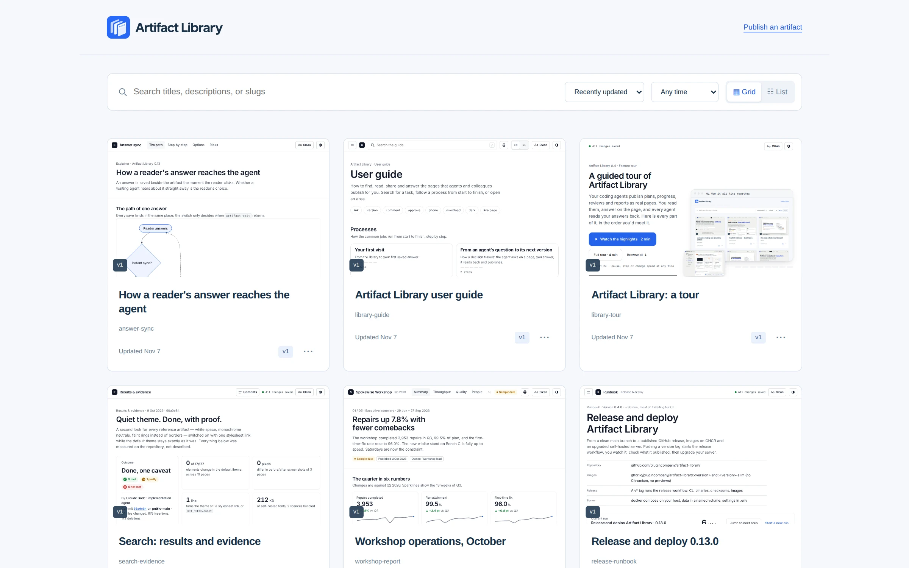

- **One command to publish any static site**: a folder of HTML, CSS, JavaScript, images, fonts, video or WebAssembly, served exactly as uploaded: `artifact publish ./review --title "Login review"`. Bring your own build or start from a reference. Without `--title` or `--description`, the page's own `<title>` and meta description are used.
- **Stable links and immutable versions.** `/artifacts/<slug>/` always shows the latest; every version stays at its own URL. Updates never change a published snapshot.
- **Server-side previews**, search over titles, descriptions and slugs, sorting, time filters and grid or list views. The search and filters are in the URL, so a filtered view can be shared.
- **Version toolbar** on every page: a link back to the library, versions with their dates and messages, stable and snapshot links, download, and a quiet "new version available" notice instead of surprise reloads. Readers can collapse it; pages can ask how much space it takes or hide it for full-screen views ([API](docs/api.md)).

### Feedback on the page, read by the agent

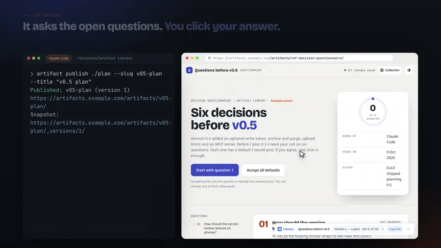

<table>
<tr>
<td width="50%">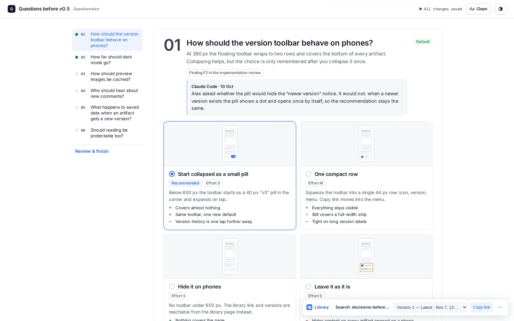</td>
<td width="50%">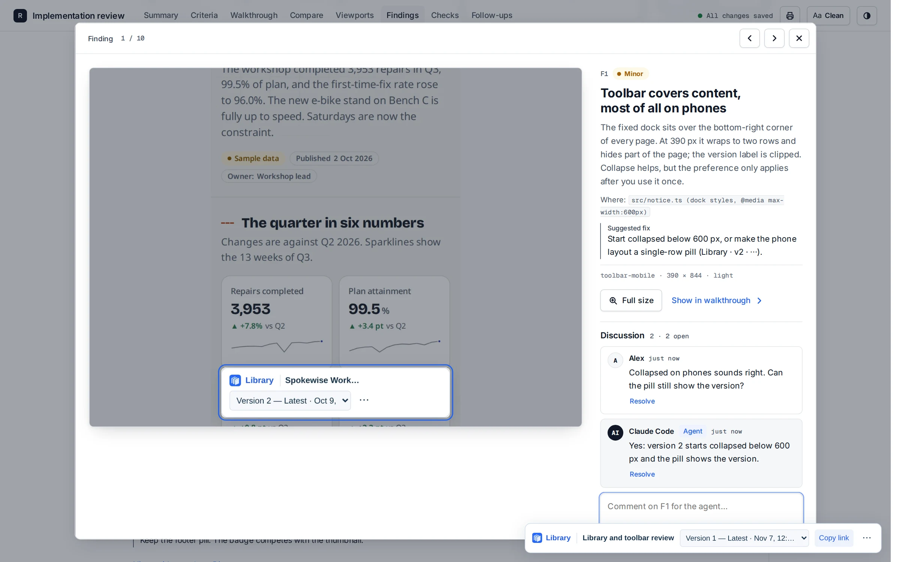</td>
</tr>
<tr>
<td><b>Questionnaires.</b> The agent asks several decisions at once; you pick options and add notes.</td>
<td><b>Reviews.</b> Comment on a finding, approve or request changes, tick follow-ups. The agent replies in the thread.</td>
</tr>
<tr>
<td>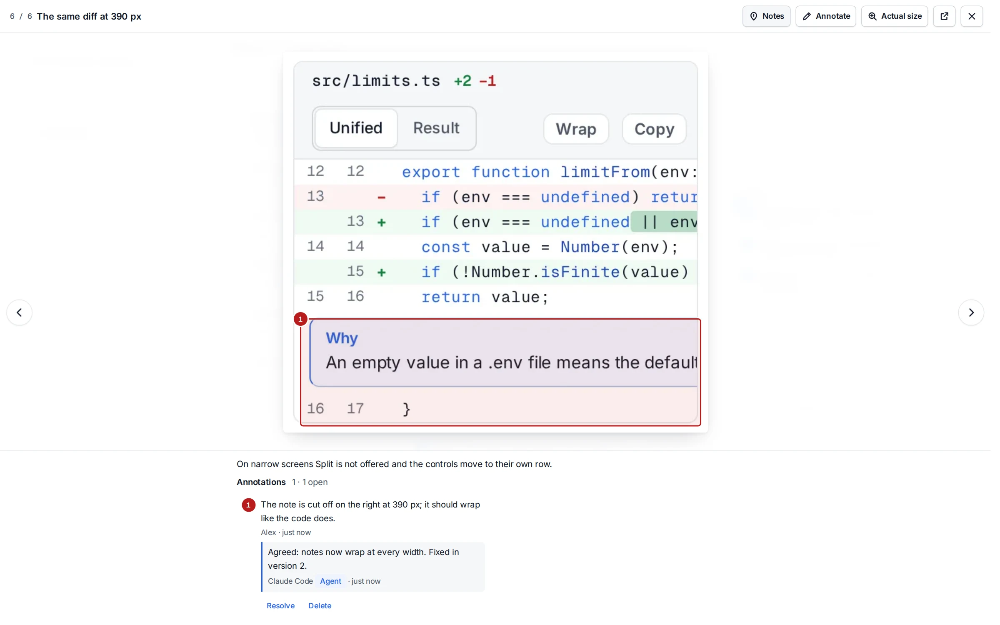</td>
<td>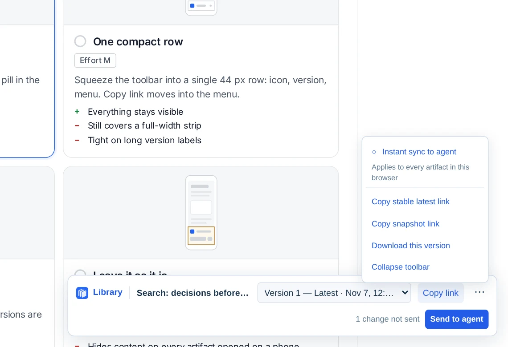</td>
</tr>
<tr>
<td><b>Marks on screenshots.</b> Open any image full size, press <i>Annotate</i>, drag a box or tap a point and say what is wrong.</td>
<td><b>You choose when the agent hears.</b> Turn off <i>Instant sync to agent</i> to collect your changes and send them in one go.</td>
</tr>
</table>

- Answers, comments, marks, verdicts and live state are **saved beside the artifact**, not inside it, so they survive new versions.
- **The agent hears back by itself**: `artifact wait <slug>` runs in the background and returns as soon as you save (or, with Instant sync off, when you press *Send to agent* or *I'm done*). `--until submitted` waits for an explicit send only, `--timeout` defaults to 24 hours.
- **Read and reply**: `artifact feedback <slug>` prints everything readers saved, including each mark on a screenshot with its region in percent and pixels. The agent **replies in the same thread** (or under a mark) with `artifact data append`; replies show on open pages within seconds, and resolved threads show up as resolved.
- Readers can delete their own marks; agents can remove any thread item and its replies with `artifact data remove-item`.
- **Live pages**: a run log the agent updates with `artifact data set` — no new versions, readers see progress within seconds.

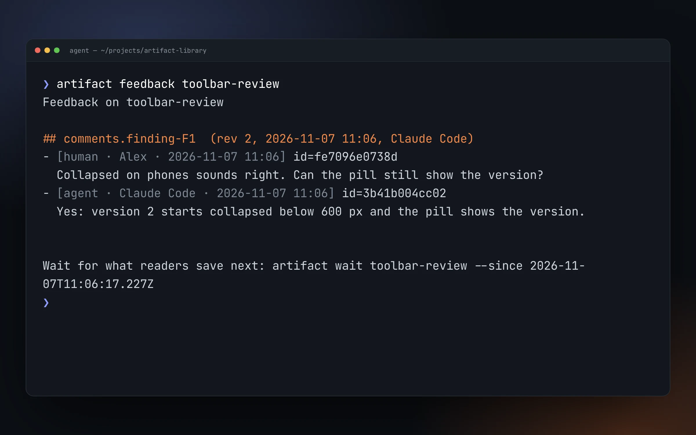

### A reference collection agents copy from

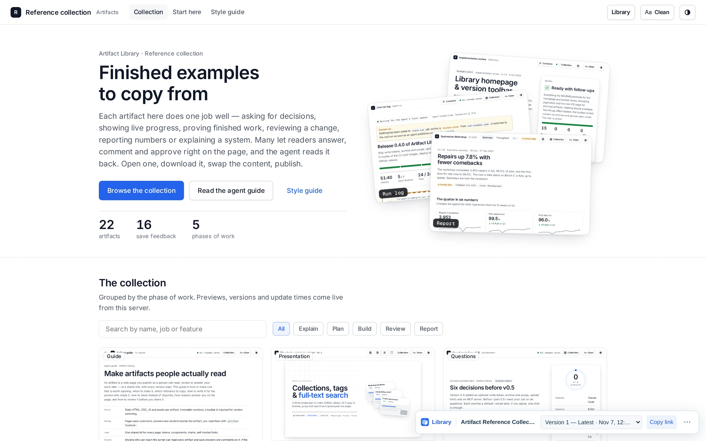

Every server ships **22 polished reference artifacts**, one per common job. Agents download the closest one, swap the content and publish; the plumbing (saving answers, comment threads, charts, print, phones) is already done. On a copy, the link back to the collection and the reference footer are hidden automatically.

| Phase | References |
|---|---|
| **Plan** | Plan deck · Decision questionnaire · Prototype variants · Scope slicer · Decision record |
| **Build** | Live run log · Debug notebook · Runbook |
| **Review** | Code review · Implementation review · Results and evidence · Code walkthrough · Visual regression · Test report |
| **Report** | Multi-page report · Weekly digest |
| **Explain** | Feature tour · User guide · Architecture tour · Codebase map |
| **Start here** | Guide for agents · CLI and skill install page |

<table>
<tr>
<td width="50%">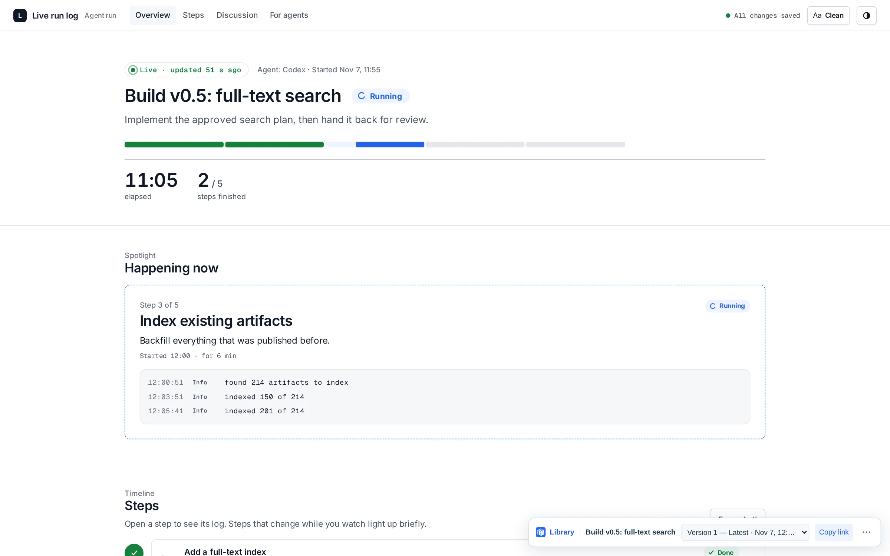</td>
<td width="50%">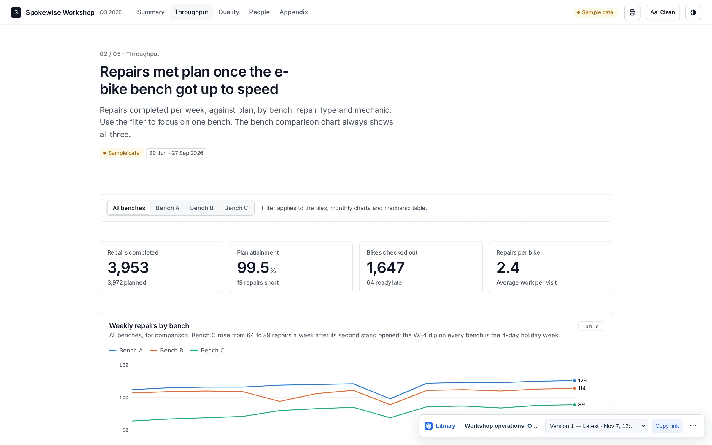</td>
</tr>
<tr>
<td><b>Live run log.</b> The agent writes progress; the page updates while you watch.</td>
<td><b>Multi-page report.</b> Charts with a table view, filters and a page per topic.</td>
</tr>
</table>

- **Seeded on every server** and updated with new releases, without overwriting your own edits or moving the references to the top of your library.
- Every reference is built on one design system, below. [See the collection →](docs/reference-collection.md)

### One design system, two styles

All references share one kit (`kit/`) with its own style guide on the collection hub: light and dark mode, phones, print, self-hosted fonts, a chapter menu that follows your reading (a top bar, or a side menu you can resize), and charts (line, column, bar, donut and sparkline) with a table view.

<table>
<tr>
<td width="50%">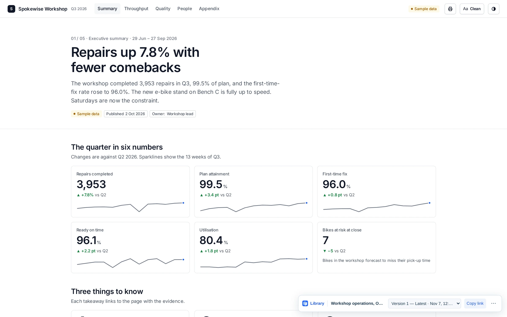</td>
<td width="50%">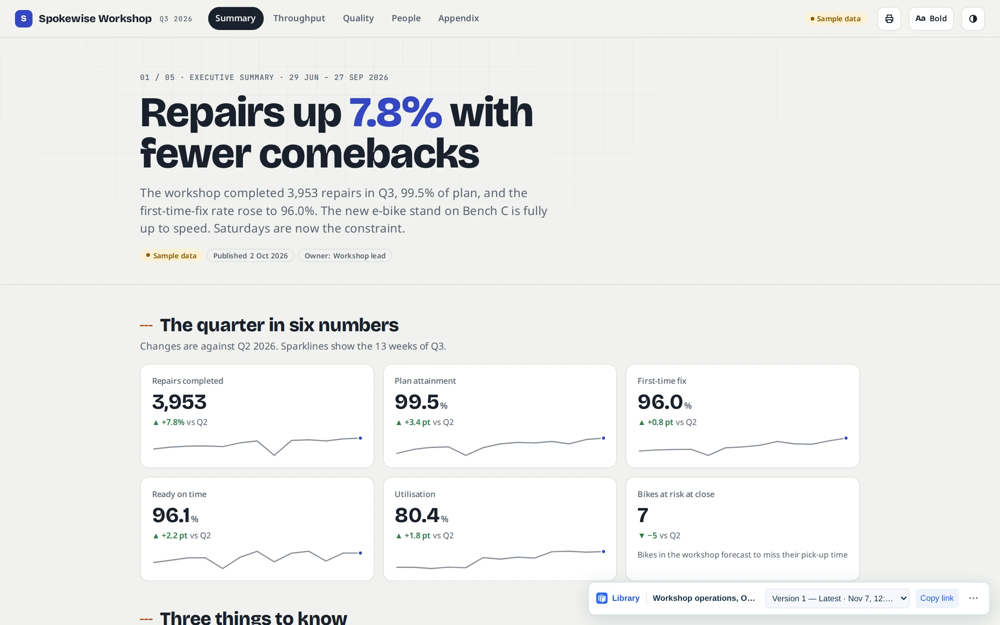</td>
</tr>
<tr>
<td><b>Clean</b>, the default. A plain documentation look: hairline borders, semibold Inter, one blue accent.</td>
<td><b>Bold.</b> Heavy display type, mono uppercase labels, dashed rules, indigo and orange accents.</td>
</tr>
</table>

Readers switch with the <i>Aa</i> button on every kit page, and their choice holds for every page on the server. Authors open a page in Bold with `<html data-kit-style="bold">`; theme tokens let you make a style of your own ([how](docs/reference-collection.md)).

### Built-in blocks for pages

The kit turns plain markup into the parts agents need most, so a page made from scratch gets them too:

<table>
<tr>
<td width="50%">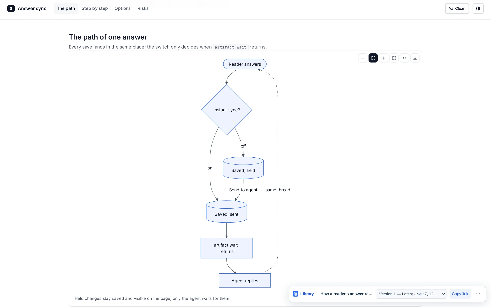</td>
<td width="50%">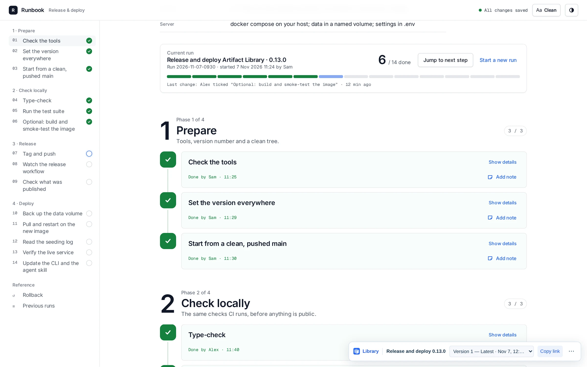</td>
</tr>
<tr>
<td><b>Diagrams.</b> Mermaid text drawn in the page's colours: flowcharts, sequence, state, ER, Gantt, mind maps and more. Readers zoom, go full screen, copy the source or download an SVG.</td>
<td><b>Shared checklists.</b> A runbook, or the to-dos the agent hands you: who ticked what and when, a note per step, archived runs.</td>
</tr>
<tr>
<td>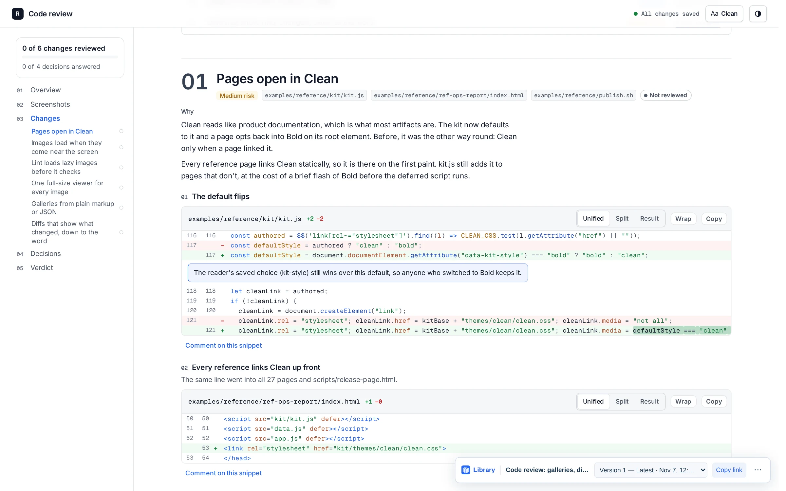</td>
<td>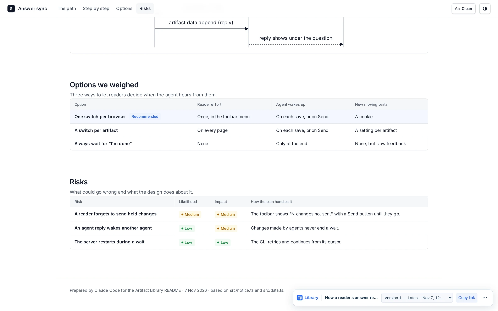</td>
</tr>
<tr>
<td><b>Code and diffs.</b> Diffs from before/after code or a <code>git diff</code>, in unified, split or result view, with notes on lines. VS Code colouring for 230+ languages, line numbers and marked lines.</td>
<td><b>Explaining.</b> Comparison tables with a recommended row, risk tables, flow diagrams, before/after and "what changes / what stays the same".</td>
</tr>
</table>

| Block | What it gives you |
|---|---|
| `[data-questions]` | Decisions as option cards with trade-offs and a recommended default, on their own page or inside a plan or review; the agent can reply on each question |
| `[data-steps]` | A shared checklist with progress, owners, due dates and a note per step; the agent can reply on each step |
| `[data-diagram]`, `pre.mermaid` | Mermaid diagrams, with the ELK layout for big graphs |
| `[data-diff]`, `pre[data-lang]` | Code diffs and syntax colouring (`data-numbers`, `data-lines`) |
| `[data-gallery]`, `img[data-lightbox]`, `img[data-src]` | Galleries in six layouts with notes on the image, a full-size viewer, lazy images |
| `img[data-annotate]` | Readers' marks on a screenshot, shown on the page |
| `[data-toc]`, `[data-flow]`, `[data-risks]`, `table.compare`, `.ba`, `.delta` | Chapter menu, flow diagram, risk table, comparison table, before/after, what changes |

Diagrams and code colouring use Mermaid, ELK and Shiki, served once by the server at `/_artifact/libs/` instead of being copied into every artifact; pages load only what they use. Each block is documented with a live example in the style guide.

### Built for agents — all of them

- **One shared library**: every agent on every machine publishes to and reads from the same server. Plans from one agent, progress from another, reviews from a third, all at stable links you and the agents can pass around.
- **Agent skill** for Claude Code, OpenCode and Codex: `artifact skill install --agent claude`. It teaches the publish → share → wait → feedback → update loop, sets a bar for clear writing and points to the reference collection.
- **MCP server**: `artifact mcp` gives any MCP client tools to search, browse recent artifacts and versions, publish, update, download, create from a reference, read feedback, wait for feedback, read and write saved data, lint and archive. The skill and the agent guide come with it.
- **Self-review with `artifact lint`**: the server renders the page at desktop and phone width and reports what a reader would trip over, with screenshots for agents that have no browser (`--screenshots <dir>`). Needs the full image, which has a browser.
- **Agent-friendly CLI**: `--json` everywhere, documented exit codes (`2` conflict, `3` lint errors, `4` wait timed out, `10` newer version on the server), idempotent uploads with `artifact retry`, optimistic revisions, `check` and `diff` against local folders, profiles for several servers.

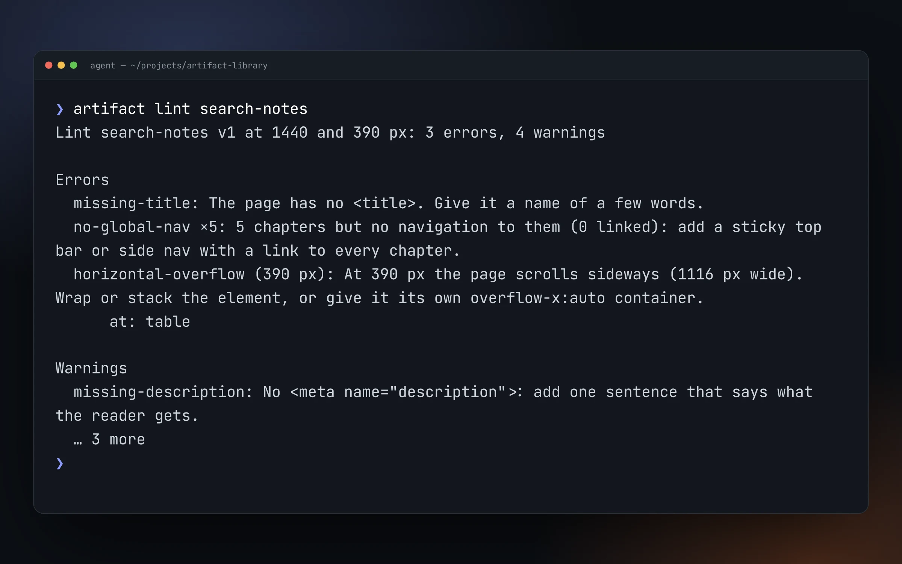

### Safe to run

- **Static only**: uploaded files are served to the browser, never executed on the server. Pages keep their own JavaScript; the version toolbar can be turned off per artifact (`--no-toolbar`).
- **Optional write token** (`ARTIFACT_TOKEN`) for publishing, updates, metadata edits, preview refresh, archive, restore and purge; reading and reader feedback stay open. The CLI keeps a token per server (`artifact config set token`) or reads `--token` / `ARTIFACT_TOKEN`.
- **Archive and purge**: hide an artifact (reversible) or delete it with all its versions and comments.
- **Upload limits** (500 MB / 10,000 files by default), limits on saved data (256 KiB per document, 500 documents per artifact, 1,000 items per thread), and pages cannot write other artifacts' data.
- Designed for private networks like a Tailscale tailnet. Read the [security model](SECURITY.md) before exposing it.

### Runs anywhere

- **One container**, one data volume, no database. Multi-arch images: full (with previews and lint) and **slim** (~290 MB).
- **CLI binaries** for Linux, macOS and Windows on x64 and arm64; the installers verify checksums. `artifact server init` writes a ready Compose file for a new server.
- Seeded defaults update themselves on upgrade and never overwrite your edits.

## How it works

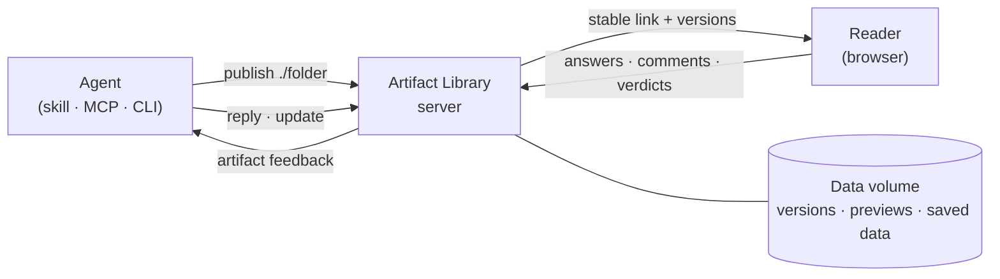

- **Versions:** every publication is a complete snapshot of a folder, stored once and served at `/artifacts/<slug>/_versions/<n>/`. The stable link `/artifacts/<slug>/` redirects to the latest.
- **Toolbar:** a small version toolbar is injected into HTML on the way out; the stored bytes never change.
- **Previews and lint:** rendered by a headless Chromium inside the full image.
- **Browser libraries:** Mermaid, ELK, Shiki and d3 are served once at `/_artifact/libs/` for every artifact on the server; kit pages load only what they use.
- **Saved data:** answers, comments, marks and live state are small JSON documents next to the versions, read and written through `/api/v1/artifacts/<slug>/data`.

## Using it with agents

```bash
# the agent, after building something
artifact download ref-implementation-review --out ./toolbar-review      # start from a reference
artifact publish ./toolbar-review --slug toolbar-review \
  --title "Library and toolbar review" --description "Criteria, annotated screenshots and findings."

# the agent waits in the background; you answer on the page and it hears back
artifact wait toolbar-review
artifact feedback toolbar-review
artifact data append toolbar-review comments.finding-F1 --author "Claude Code" \
  --item '{"text":"Yes: version 2 starts collapsed below 600 px and the pill shows the version."}'
artifact update toolbar-review ./toolbar-review --message "Start the toolbar collapsed on phones"
```

More in [docs/agents.md](docs/agents.md).

## Configuration

| Server variable | Default | |
|---|---|---|
| `PUBLIC_BASE_URL` | `http://localhost:3000` | Origin used in links the API returns |
| `ARTIFACT_TOKEN` | unset | Require a bearer token for writes |
| `MAX_UPLOAD_BYTES` / `MAX_FILES` | 500 MB / 10,000 | Per-upload limits (`0` = unlimited) |
| `PREVIEWS` | on (full) / off (slim) | Server-side preview images |
| `SEED` | on | Seed the reference collection and agent guide (`false` turns it off) |
| `LIBS_DIR` | `libs/dist/` in the image | Browser libraries served at `/_artifact/libs/` (diagrams, code colouring) |

`DATA_DIR`, `PORT`, `HOST`, `LOG_LEVEL`, `SEED_DIR` and the Compose-only settings, plus Compose file, reverse proxy and Tailscale examples, backups and upgrades: [docs/deployment.md](docs/deployment.md).

## Documentation

| | |
|---|---|
| [CLI reference](docs/cli.md) | Every command, configuration, profiles, exit codes |
| [Agents](docs/agents.md) | Skill, MCP server, the feedback loop |
| [Saved data](docs/saved-data.md) | Answers, comments and live state from pages and agents |
| [Reference collection](docs/reference-collection.md) | The 22 references, the shared kit and its themes |
| [Deployment](docs/deployment.md) | Docker, Compose, TLS, backups, upgrades |
| [HTTP API](docs/api.md) | Routes, headers, errors |
| [Release process](docs/release-process.md) | How releases are built and published |
| [Changelog](CHANGELOG.md) | What changed in every release |
| [Intro video](docs/video/README.md) | How the intro video and these screenshots are made |

## Contributing

Issues and pull requests are welcome — see [CONTRIBUTING.md](CONTRIBUTING.md) and the [code of conduct](CODE_OF_CONDUCT.md). Report security issues privately as described in [SECURITY.md](SECURITY.md).

```bash
npm ci && npm test        # Node.js 22+
npm run dev               # server on http://localhost:3000
```

## License

[MIT License](LICENSE). The name "Artifact Library" and its logo are trademarks of Plugin Company; forks are welcome under a different name (see [NOTICE](NOTICE)).
